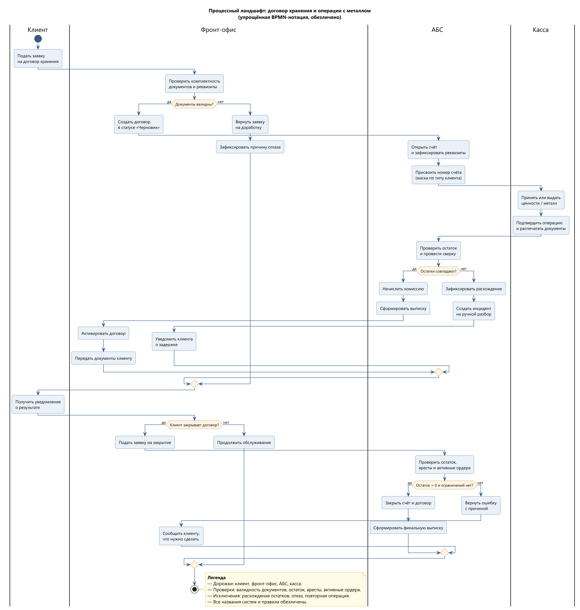
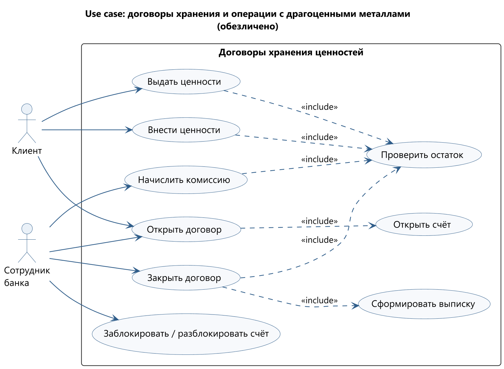
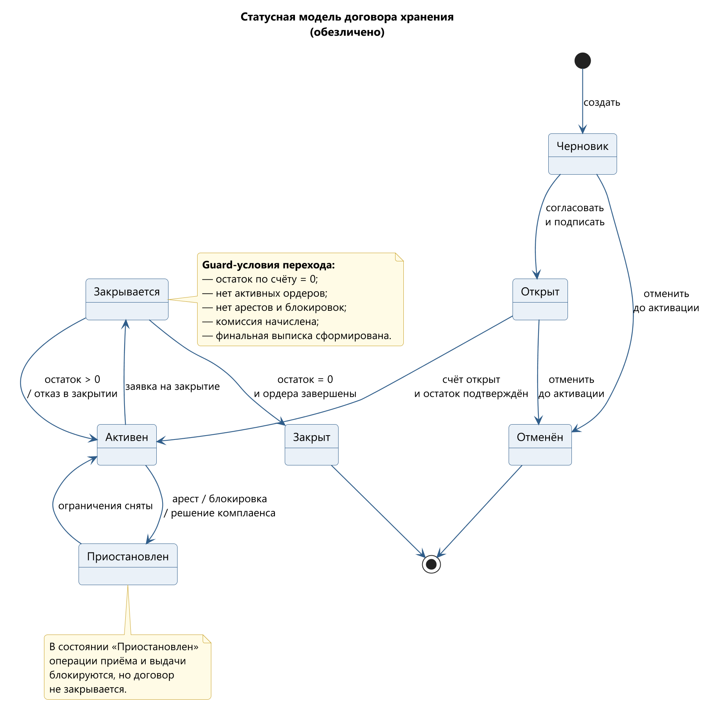
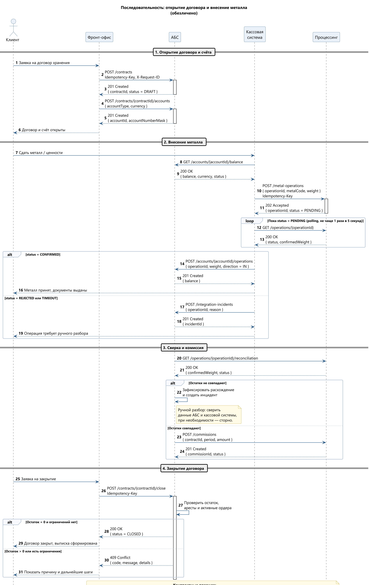
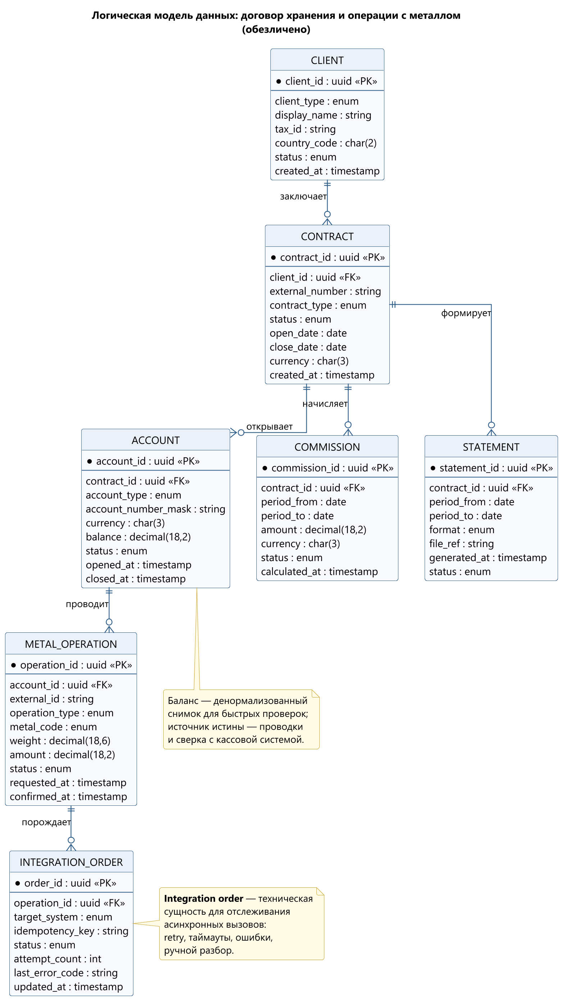
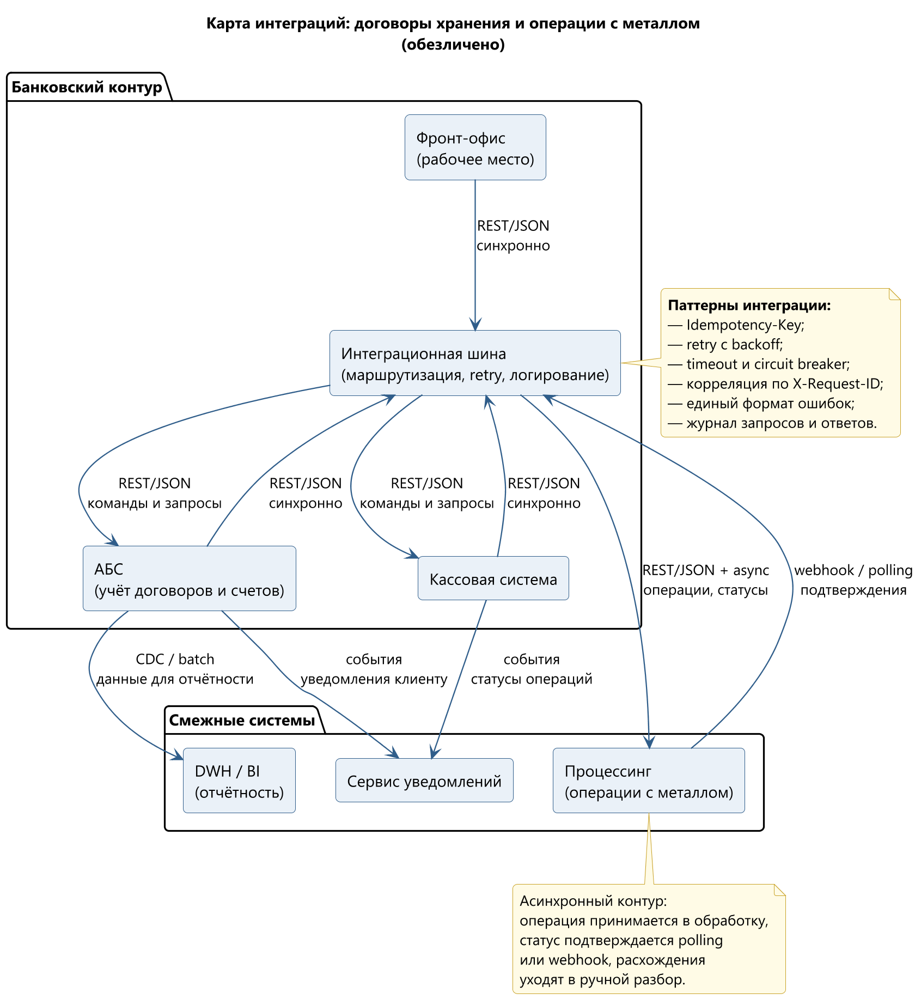

# Портфолио системного аналитика

Банковские интеграции: требования, BPMN/UML, OpenAPI, UAT.
2+ года в банковских проектах, домен — АБС, касса, фронт-офис, договоры и счета.

> Все материалы обезличены: названия банка и систем, API-пути, поля и идентификаторы заменены. Схемы перерисованы с нуля.

## Кейс

**Договоры хранения ценностей и операции с драгоценными металлами.**

Четыре системы — фронт-офис, АБС, касса и процессинг; 20+ REST-операций и три канала обслуживания.

Роль — системный аналитик end-to-end: интервью и scope, AS-IS/TO-BE, BRD/FRD, BPMN/UML, API-контракты, маппинг данных, UAT, запуск и передача в поддержку.

Результат: согласованный сквозной процесс, прозрачные статусы и ошибки, снижение MTTR интеграционных инцидентов на 40%.

## Схемы

**Процесс по дорожкам** — клиент → фронт-офис → АБС → касса.

**Use case** — границы системы, акторы и include-связи.

**State machine** — статусы договора, переходы и guard-условия.

**Sequence** — открытие договора, внесение металла, сверка и закрытие.

**ERD** — клиент, договор, счёт, операция, ордер, комиссия, выписка.

**Карта интеграций** — системы, протоколы, синхронный и асинхронный контуры.

## Артефакты

- [Требования](examples/requirements.md) — BRD/FRD: цели, scope, FR/NFR, бизнес-правила.
- [OpenAPI 3.0](examples/api.yaml) — операции, схемы, ошибки, идемпотентность.
- [UAT](examples/uat.md) — сценарии и критерии входа/выхода.

## Стек

BPMN 2.0 · UML · ERD · OpenAPI · REST/SOAP · SQL · Jira · Confluence · PlantUML

## Контакты

- GitHub: [github.com/Balur77/cv_yushkevich](https://github.com/Balur77/cv_yushkevich)
- Email: [yv10082006@gmail.com](mailto:yv10082006@gmail.com)

Лицензия: [MIT](LICENSE) для кода и шаблонов, CC BY 4.0 для текстов и схем.

